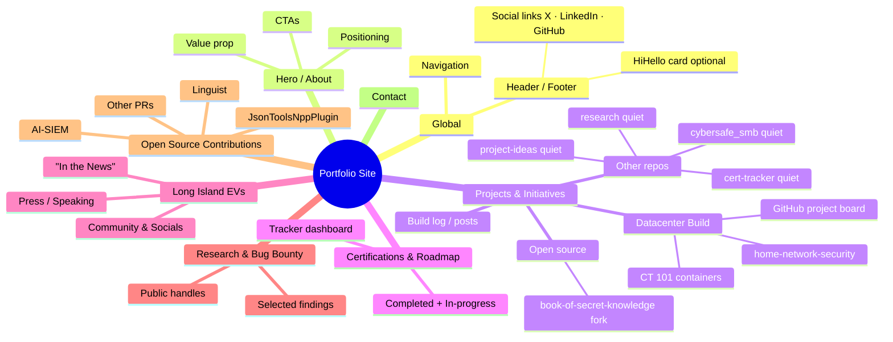

# Portfolio Content Outline

> Living document for jacob-kraniak.github.io  
> Last updated: 2026-11-16  
> Status: Live site split projects into an initiative, a build log, and a repo list  
> Branch: `docs/content-outline`

This file is **internal documentation only**. It is not rendered on the live site. Use it as a single source of truth while gathering and refining content.

---

## Site Map (Mindmap)

---

## 1. Global Elements

- **Header / Footer**
  - Social links: X (`@JacobSk92`), LinkedIn, GitHub
  - Optional: HiHello digital business card (easy contact exchange)
- **Navigation**: Home · Datacenter Build · Posts · Repos (`/projects`) · Certifications · Long Island EVs · Research · Open source · CV · Contact · Referrals (`/referrals`, last in the sidebar). Labels live in `src/data/site.yml`.

## 2. Hero / About

- Short professional positioning (Security Systems Engineer + cybersecurity practitioner + community builder)
- One-sentence value proposition
- Primary CTAs: Resume · Contact · View Projects
- Inspirational Quotes. My favorite quotes from tech leaders, authors, film/tv that align with my core principles and values.

## 3. Projects & Initiatives

The live site splits this into three pieces. Do not put the copy back into a component.

| Piece | URL | File |
|---------|-----|------|
| Datacenter Build initiative | `/datacenter-build` | `src/data/datacenter-build.yml` |
| Build log | `/posts`, `/posts/<slug>`, `/posts/project/<id>`, `/posts/tag/<tag>`, `/rss.xml` | `src/content/posts/*.md` |
| Other repos | `/projects` | `src/data/repos.yml` |

- **Datacenter Build** ties together `home-network-security`, the containers on CT 101 (no separate repo), and GitHub project 1. Phase 1 network build is done. Phase 2 self-hosted services is in progress. Phase 3 routing and remote access is future. The old containerized-apps placeholder is this initiative, not its own card.
- **Posts** are Markdown with frontmatter (`title`, `pubDate`, `description`, `project`, `tags`, optional `draft`). `draft: true` is omitted from production builds. Seed notes for review live in `src/content/posts/` and are marked with an HTML comment.
- **Other repos** use status `active`, `quiet`, or `idea`. As of 2026-11-15: HNS is active and is not in this list. cert-tracker, cybersecurity-research, and Project-ideas are quiet. cybersafe_smb is quiet (last public commit 2026-03-14). The book-of-secret-knowledge fork is under Open Source, not here. Cert-tracker stays linked from `/certs`.

## 4. Certifications & Learning Roadmap

- Source of truth: `cybersecurity-certification-tracker`
- Display as a clean dashboard / progress timeline (not a plain list)
- Show both completed certifications and the current roadmap

## 5. Long Island EVs (dedicated section or sub-page)

- Mission & community impact
- Social presence (X, Instagram, YouTube, Linktree)
- Press / speaking appearances (“In the News”)
  - Farmingdale State College EV Symposium speaker
  - Newsday mentions, Drive Electric Long Island volunteer work, etc.
- Link out to the separate LongIslandEVs presence

## 6. Research & Bug Bounty

- Public handles: Bugcrowd, Intigriti, etc. (confirm public profiles)
- High-level stats or selected public findings only (no sensitive details)

## 7. Open Source Contributions

- Notable public contributions / merged PRs
  - AI-SIEM
  - Linguist
  - JsonToolsNppPlugin
  - Others as they appear
- GitHub profile highlights

## 8. Contact

- Preferred contact methods
- HiHello card (if integrated)
- Social links repeated for convenience

## 9. Referrals

- Plain list at `/referrals`. Copy and the link list live in `src/data/referrals.yml`.
- Only `active: true` entries with a URL are rendered. Inactive rows stay in the file.
- Short disclosure on the page: a signup through a link may earn a credit. No sponsorships.
- Notes are one line each. Placeholders stay until Jacob writes why he uses the product.

---

## Maintenance Notes

- This file is **internal documentation only** — it must never be rendered on the live site.
- Update the Status column and the mindmap as content is written or priorities change.
- Always respect NDAs for any employer-related work.
- Prefer linking to public repos rather than duplicating large amounts of content.
- When a section is ready for the live site, move the polished copy into the matching file under `src/data/` (page copy, nav, social links, the initiative, the repo list, and referral links) or `src/content/posts/` (a build-log note). Certification rows stay in `certs.json`. The repository README lists which file holds which section. Leave a note here.

---

*Next actions:*  
1. Fill in actual copy for the highest-priority sections.  
2. Decide which projects become full case studies vs. simple cards.  
3. Decide on HiHello integration approach.  
4. Confirm public bug-bounty handles.
